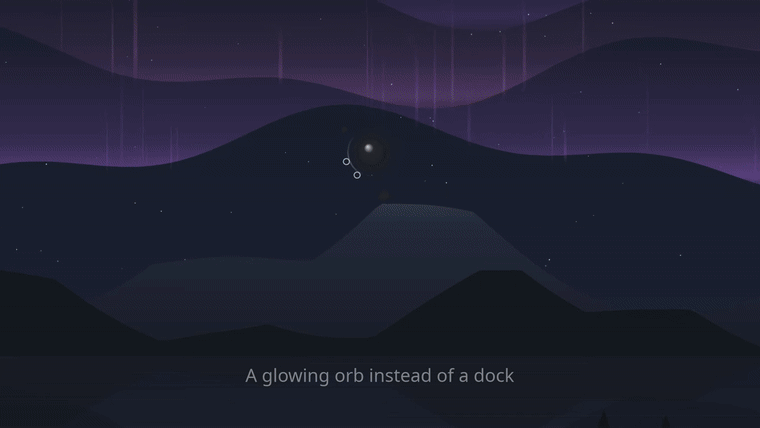
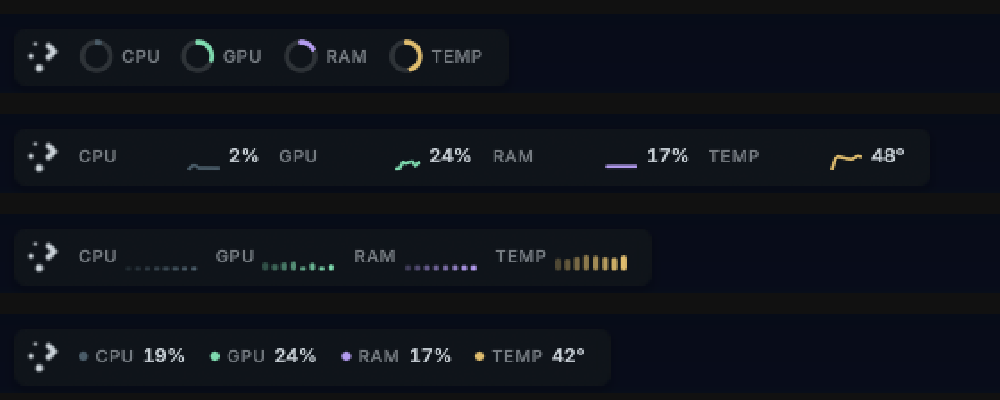
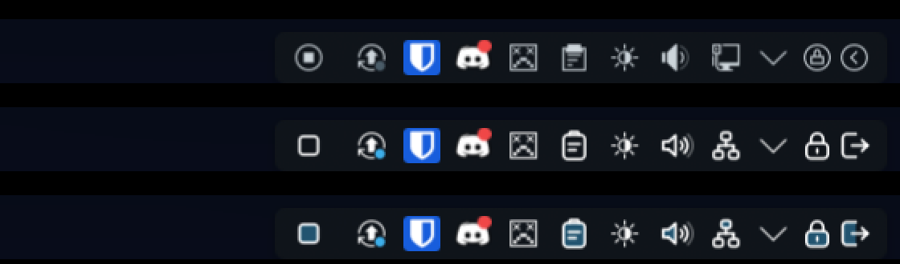

<p align="center">
  
</p>

<p align="center">
  <br>
  <b>A calm, living desktop for KDE Plasma 6.</b><br>
  A glowing orb instead of a dock · wallpapers that breathe with your day · notifications that grow out of the clock
</p>

<p align="center">
  
  
  
  
</p>

<p align="center">
  <br>
  <sub><a href="https://github.com/Panto92/Pillbox/releases/latest">Watch the full 80-second tour (1080p)</a></sub>
</p>

> **Pillbox OS is not a distribution.** It turns the Plasma 6 you already have –
> Kubuntu, Fedora KDE, Arch, openSUSE, KDE neon … – into its own desktop, and
> `./uninstall.sh` brings your old one back.

---

## Why Pillbox

Most desktops with this look are built on Hyprland and need a dozen moving parts.
Pillbox gets there with **plain Plasma**:

- **Nothing compiled** – only QML, SVG and Plasma's own scripting. It survives Plasma updates.
- **Only official interfaces.** No patched files, no hacks into Plasma.
- **Measured, not guessed.** Every animated part is checked for CPU cost; a covered wallpaper costs nothing.
- **Reversible.** Installs into your home folder, keeps a backup of your settings, removes itself cleanly.
- **One settings centre** for everything – no hunting through ten dialogs.

## Install

```bash
git clone https://github.com/Panto92/Pillbox.git pillbox
cd pillbox
./install.sh            # install only – your desktop does not change yet
./install.sh --apply    # + Pillbox colours, style and icons; your panels stay
./install.sh --layout   # + the full Pillbox layout: orb, island clock, living wallpaper
```

Your settings are backed up to `~/.local/share/pillbox/` first. Requirements: KDE Plasma 6.0 or newer (Wayland recommended).

```bash
./uninstall.sh                # back to your desktop as it was before Pillbox
./uninstall.sh --keep-layout  # keep your current panels, only remove Pillbox
```

Afterwards: right-click the orb → **Customize…** opens the settings centre.

---

## The Orb

A glowing ball instead of a dock. Put it anywhere, on any monitor.

| | |
|---|---|
| **Click** | a ring of your pinned and running apps |
| **Hover an app** | live previews of its windows |
| **Click a running app** | brings it to the front – or minimises it into the orb |
| **Drag** | anywhere you like; lock it from the menu |
| **Satellites** | your open windows orbit the ball |
| **All applications** | a full-screen launcher with search |

Not a fan of floating balls? Pick another **form** with the same behaviour:
**Ember** (a seam of glowing dots that unfolds), **Shelf** (icons on a glass ledge) or
**Liquid** (a dock of liquid glass). Docks go bottom, left or right, on one or all monitors.

## Living wallpapers

<p align="center"></p>

Ten **atmospheres** follow the time of day – blue hour, noon, evening glow, stars –
and quietly show what your computer is doing, without a single number:

| | | Busy CPU | Busy GPU | New notification |
|---|---|---|---|---|
| **Flow** | soft clouds of colour | drift faster | warmer tones | a ring of light |
| **Horizon** | flat hills, one sun | haze drifts through | the sun grows warmer | a flock of birds |
| **Fogline** | misty lake under mountains | denser fog | ridges glow | rings on the water |
| **Dune** | desert dunes | sand blows over the crests | heat shimmer | a shooting star |
| **Aurora** | a Norwegian fjord in polar night | the aurora dances | the hut lights up | snowfall |
| **Tide** | open sea | waves grow | the sea glows | rain |
| **Neon** | a city at night | more windows light up | signs glow | rain on a wet street |
| **Orbit** | a ringed planet | the belt turns faster | the atmosphere glows | a comet |
| **Contour** | topographic lines | lines move more | valleys glow | a wave runs through |
| **Grid** | a calm field of dots | a wave of light | the centre glows | a ping |

Each scene has its own options (colours, fog, sea, rain …), a **Try it** button and a
time slider – follow the clock or keep it at, say, 14:30.

**Cost** (3440×1440 + 1080×1920, share of one CPU core above a plain image):
Fogline/Horizon ≈ +2 %, Flow ≈ +6 %, and **0** while a maximised or fullscreen window covers the screen.
All motion shares one slow clock, because for a wallpaper the cost is how often the screen is redrawn.

## The island clock

<p align="center"></p>

The clock in the middle **grows into an island** when a notification arrives – with
reply field and actions – and shrinks back. A dot stays until you've looked. A click
on the clock opens the calendar, your notifications and *Do Not Disturb*.
Plasma stays the notification server, so history, sounds and DND keep working.

## Load, icons and the top bar

<p align="center"></p>

CPU, GPU, memory and temperature as **rings, curves, bars or numbers**; a click
shows the last minute as large curves.

<p align="center"></p>

Pillbox brings its **own system icons** in two styles – *line* and *duotone*, which
puts your accent colour underneath. Shown above: Breeze, Pillbox line, Pillbox duotone.

## Login screen

The login screen gets the same treatment: a living atmosphere that fits the time of
day, a large clock and one glass card with your picture. Set it up once from the
settings centre (**Login screen → Set up…**, asks for your password because login
screens are system-wide); after that you change it there without a password.
Systems with another login manager (GDM, LightDM …) are detected and left alone.

## Settings centre

Right-click the orb or a dock → **Customize…**: a glass window with a sidebar –
Form, Color, Wallpaper, Login screen, Top bar, Behavior, Alerts, About. Every change
applies **live**.

---

## Roadmap

Pillbox is a long-term project; every idea from the sketches in [`docs/lab`](docs/lab)
becomes an option you can switch on.

- [x] Orb and three dock forms
- [x] Ten living wallpapers with their own options
- [x] Island clock with notification islands
- [x] Login screen
- [x] Load pill in four styles, own icon themes
- [ ] Status pill with own panels (network, sound, bluetooth, session)
- [ ] Arrangements: islands, one capsule, a rail at the screen edge, corners, a halo around the orb
- [ ] Click effects: grow, slide in, bloom
- [ ] Music module and control centre

## Languages

Pillbox is written in English and follows your system language; German is included
everywhere. Translations live in [`po/`](po) – copy a `de.po`, translate the `msgstr`
lines and open a pull request. New languages are very welcome.

## Contributing

Ideas, bug reports and pull requests are welcome – open an issue first for larger
changes. Behaviour spec of the orb: [docs/orb.md](docs/orb.md).

## Credits

The look was inspired by [43PR's Hyprland dotfiles](https://github.com/43PR/dotfiles)
(MIT). Pillbox is an independent implementation for KDE Plasma and contains no code
from that project.

## License

[MIT](LICENSE)
