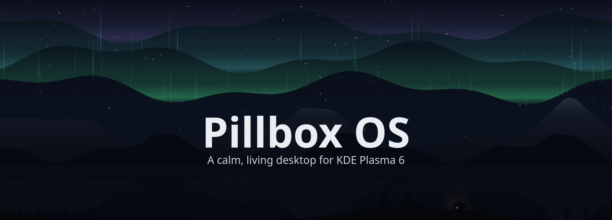
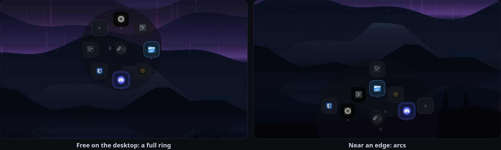
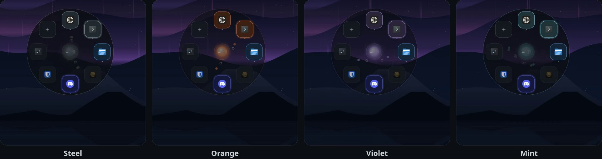
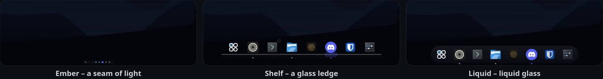
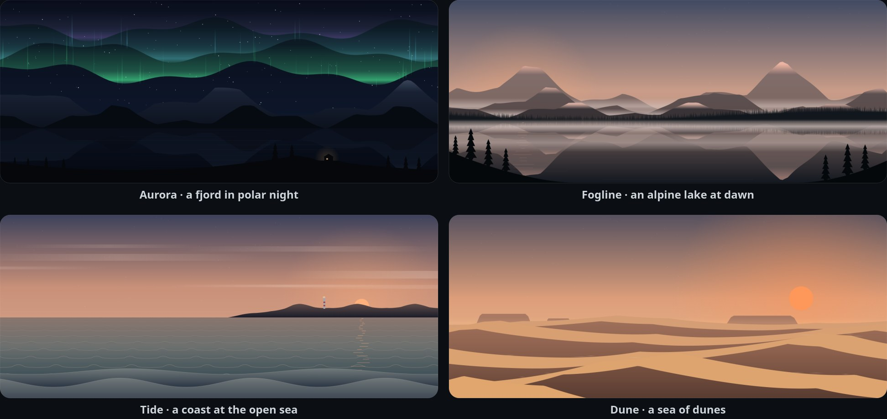
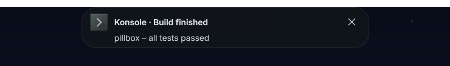

<p align="center">
  
</p>

<p align="center">
  <br>
  <b>A calm, living desktop for KDE Plasma 6.</b><br>
  A glowing orb instead of a dock · wallpapers that breathe with your day · a clock that shows what's running · frosted search
</p>

<p align="center">
  <a href="https://github.com/Panto92/Pillbox/releases/latest"></a>
  <a href="https://github.com/Panto92/Pillbox/releases"></a>
  <a href="https://github.com/Panto92/Pillbox/stargazers"></a>
  
  
  
</p>

<p align="center">
  <br>
  <sub><a href="https://github.com/Panto92/Pillbox/releases/latest">Watch the full 80-second tour (1080p)</a></sub>
</p>

> **Pillbox OS is not a distribution.** It turns the Plasma 6 you already have –
> Kubuntu, Fedora KDE, Arch, openSUSE, KDE neon … – into its own desktop, and
> `./uninstall.sh` brings your old one back.

---

## Why Pillbox

Most desktops with this look are built on Hyprland and need a dozen moving parts.
Pillbox gets there with **plain Plasma**:

- **Nothing compiled** – only QML, SVG and Plasma's own scripting. It survives Plasma updates.
- **Only official interfaces.** No patched files, no hacks into Plasma.
- **Measured, not guessed.** Every animated part is checked for CPU cost; a covered wallpaper costs nothing.
- **Reversible.** Installs into your home folder, keeps a backup of your settings, removes itself cleanly.
- **One settings centre** for everything – no hunting through ten dialogs.

## Install

```bash
git clone https://github.com/Panto92/Pillbox.git pillbox
cd pillbox
./install.sh            # install only – your desktop does not change yet
./install.sh --apply    # + Pillbox colours, style and icons; your panels stay
./install.sh --layout   # + the full Pillbox layout: orb, island clock, living wallpaper
```

Or without git: download `pillbox-<version>.tar.gz` from the [latest release](https://github.com/Panto92/Pillbox/releases/latest),
unpack it and run `./install.sh --layout` inside.

Your settings are backed up to `~/.local/share/pillbox/` first. Requirements: KDE Plasma 6.0 or newer (Wayland recommended).

```bash
./uninstall.sh                # back to your desktop as it was before Pillbox
./uninstall.sh --keep-layout  # keep your current panels, only remove Pillbox
```

Afterwards: open **Pillbox OS** from your applications (or right-click the orb → **Customize…**) for the settings centre.
Pillbox can be switched off and on again at any time – right-click the Pillbox OS icon, or:

```bash
pillbox off      # back to your usual Plasma desktop, Pillbox is kept
pillbox on       # and back to Pillbox
```

---

## The Orb

A glowing ball instead of a dock. Put it anywhere, on any monitor.

<p align="center"></p>

| | |
|---|---|
| **Click** | a ring of your pinned and running apps |
| **Hover an app** | live previews of its windows |
| **Click a running app** | brings it to the front – or minimises it into the orb |
| **Drag** | anywhere you like; lock it from the menu |
| **Satellites** | your open windows orbit the ball |
| **All applications** | a full-screen launcher with search |

Any colour you like – pick a preset or mix your own; it can become the accent of the whole system, too.

<p align="center"></p>

Not a fan of floating balls? Pick another **form** with the same behaviour:
**Ember** (a seam of glowing dots that unfolds), **Shelf** (icons on a glass ledge) or
**Liquid** (a dock of liquid glass). Docks go bottom, left or right, on one or all monitors,
and *smart hiding* slides them away only while a window needs the space.

<p align="center"></p>

## Living wallpapers

<p align="center"></p>

Eleven **atmospheres** follow the time of day – blue hour, noon, evening glow, stars –
and quietly show what your computer is doing, without a single number:

| | | Busy CPU | Busy GPU | New notification |
|---|---|---|---|---|
| **Flow** | soft clouds of colour | drift faster | warmer tones | a ring of light |
| **Horizon** | flat hills, one sun | haze drifts through | the sun grows warmer | a flock of birds |
| **Fogline** | misty lake under mountains | denser fog | ridges glow | rings on the water |
| **Dune** | desert dunes | sand blows over the crests | heat shimmer | a shooting star |
| **Aurora** | a Norwegian fjord in polar night | the aurora dances | the hut lights up | snowfall |
| **Tide** | open sea | waves grow | the sea glows | rain |
| **Neon** | a city at night | more windows light up | signs glow | rain on a wet street |
| **Yule** | a snowed-in village on a winter night | it snows harder | the lights glow brighter | a sleigh crosses the moon |
| **Orbit** | a ringed planet | the belt turns faster | the atmosphere glows | a comet |
| **Contour** | topographic lines | lines move more | valleys glow | a wave runs through |
| **Grid** | a calm field of dots | a wave of light | the centre glows | a ping |

Each scene has its own options (colours, fog, sea, rain …), a **Try it** button and a
time slider – follow the clock or keep it at, say, 14:30.

**Cost** (3440×1440 + 1080×1920, share of one CPU core above a plain image):
Fogline/Horizon ≈ +2 %, Flow ≈ +6 %, and **0** while a maximised or fullscreen window covers the screen.
All motion shares one slow clock, because for a wallpaper the cost is how often the screen is redrawn.

## The top bar

Three floating pills – or one full bar, or a single capsule. They stay normal Plasma panels:
right-click → *Enter Edit Mode* to add, move or remove your own widgets.

**Left – load at a glance.** The Pillbox logo opens your applications, a magnifier opens the
search, and CPU, GPU, memory and temperature say what they are: `RAM 11,6 / 32 GB`, the GPU with
its own temperature and video memory. Text with bars, rings with numbers or calm chips. A click
shows the last minute as curves, the processor and graphics card in detail, your drives with free
space, and a tidy-up for the trash and the thumbnail cache.

**Right – one status pill** for music, sound, Bluetooth, network and power, each with its own
panel: the cover with a waveform, a volume ring you can drag and every output and app, paired
devices with their battery, your computer as a little network map with live speeds, power profiles,
*Stay awake* and the session (lock, sleep, restart – the risky ones ask twice). The system tray keeps
your apps' own icons; everything Pillbox shows already is taken out of it (`pillbox untidy` gives it back).

**Size and icons.** Normal, large or extra large; Pillbox's own *Lucide* icon theme (clean round
lines) for the bar, the tray and every panel – or the older line and duotone sets.

## Search

**Meta+Space** frosts the whole screen and puts one large glass search field in the middle –
apps, files, settings, windows, a calculator: everything KRunner finds. Typing on the desktop opens
KRunner itself, which now floats in the middle as well.

## The island clock

<p align="center"></p>

The clock in the middle **grows into an island** when a notification arrives – with
reply field and actions – and shrinks back. A dot stays until you've looked.
Plasma stays the notification server, so history, sounds and DND keep working.

**Live activities** sit beside the time while something runs: a ring for downloads and copies,
the cover and dancing bars for music, a timer counting down, a microphone that is in use,
a laptop that is charging. A second one waits as a small bubble; hover for a card with the details
and controls.

A click opens the **dashboard**: a large clock, the month, the weather for your town (Open-Meteo,
only after you enter a place), a quick timer and your notifications.

## Colour

Pick any colour for the orb – presets or your own – and choose how far it reaches: **only the orb**,
the **accent** of every KDE app, or the **whole system**, where bars, popups and windows take on a
light tint of it as well. Very dark colours get a readable accent automatically. Popups are frosted
glass: KWin blurs what lies behind them.

## Login screen

The login screen gets the same treatment: a living atmosphere that fits the time of
day, a large clock and one glass card with your picture. Set it up once from the
settings centre (**Login screen → Set up…**, asks for your password because login
screens are system-wide); after that you change it there without a password.
Systems with another login manager (GDM, LightDM …) are detected and left alone.

## Settings centre

Open **Pillbox OS** from your applications, or right-click the orb or a dock → **Customize…**:
a glass window with a sidebar – Form, Color, Wallpaper (the atmospheres as slanted strips you flip
through with the wheel), Login screen, Top bar, Behavior, Alerts, About. Every change applies **live**.

---

## Roadmap

Pillbox is a long-term project; every idea from the sketches in [`docs/lab`](docs/lab)
becomes an option you can switch on.

- [x] Orb and three dock forms
- [x] Eleven living wallpapers with their own options
- [x] Island clock with notification islands
- [x] Login screen
- [x] Load pill in four styles, own icon themes
- [x] Status pill with own panels (music, sound, Bluetooth, network, power, session)
- [x] Live activities in the island, clock dashboard with weather
- [x] Frosted search, Lucide icons, colour for the whole system
- [x] Pillbox OS app: settings, switch off and on
- [ ] Arrangements: islands, one capsule, a rail at the screen edge, corners, a halo around the orb
- [ ] Click effects: grow, slide in, bloom
- [ ] Equalizer, focus and gaming modes, colours from the album cover

## Languages

Pillbox is written in English and follows your system language; German is included
everywhere. Translations live in [`po/`](po) – copy a `de.po`, translate the `msgstr`
lines and open a pull request. New languages are very welcome.

## Contributing

Ideas, bug reports and pull requests are welcome – open an issue first for larger
changes. Behaviour spec of the orb: [docs/orb.md](docs/orb.md).

## Credits

The look was inspired by [43PR's Hyprland dotfiles](https://github.com/43PR/dotfiles)
(MIT). Pillbox is an independent implementation for KDE Plasma and contains no code
from that project.

## License

[MIT](LICENSE)
